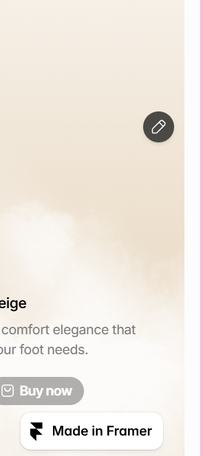
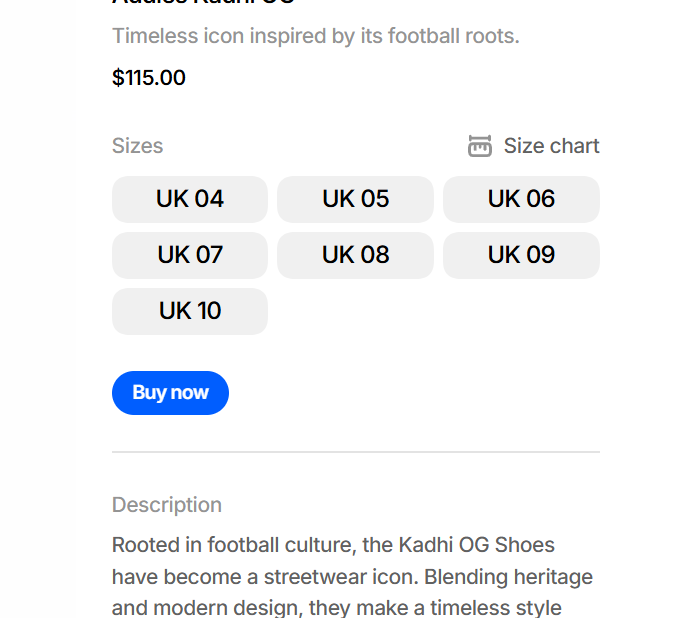
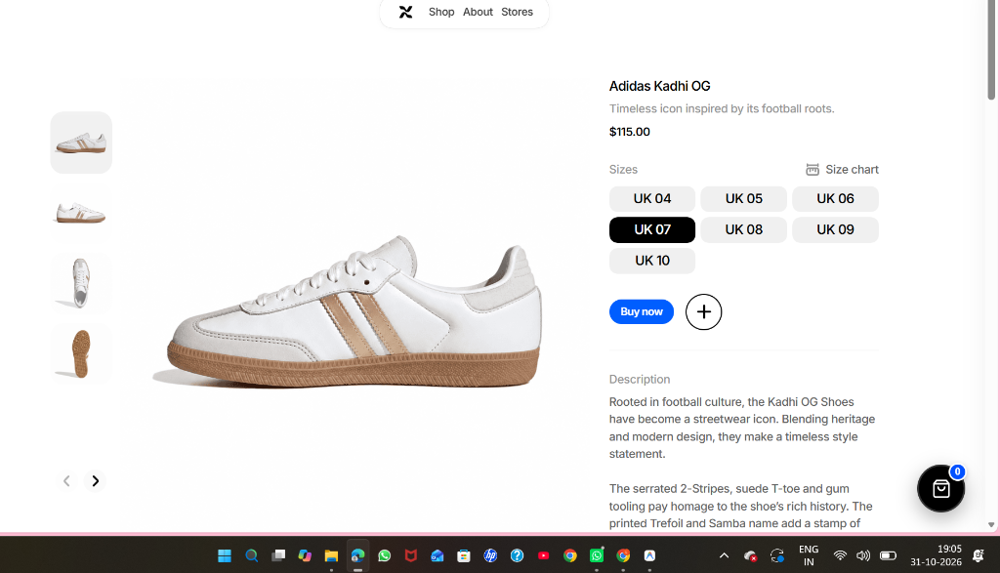
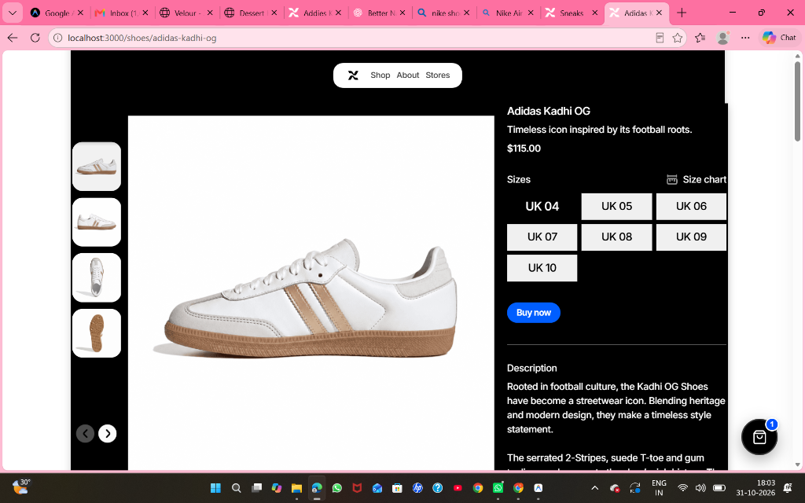
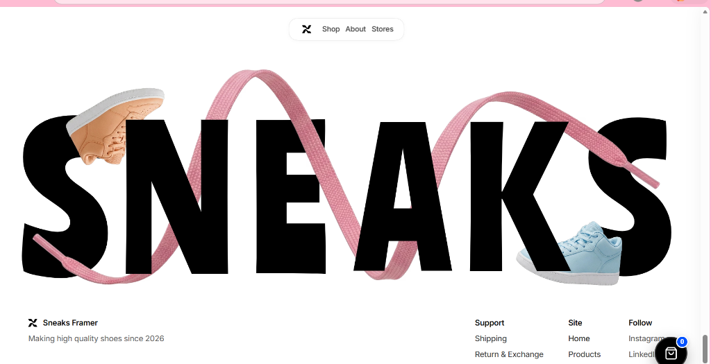
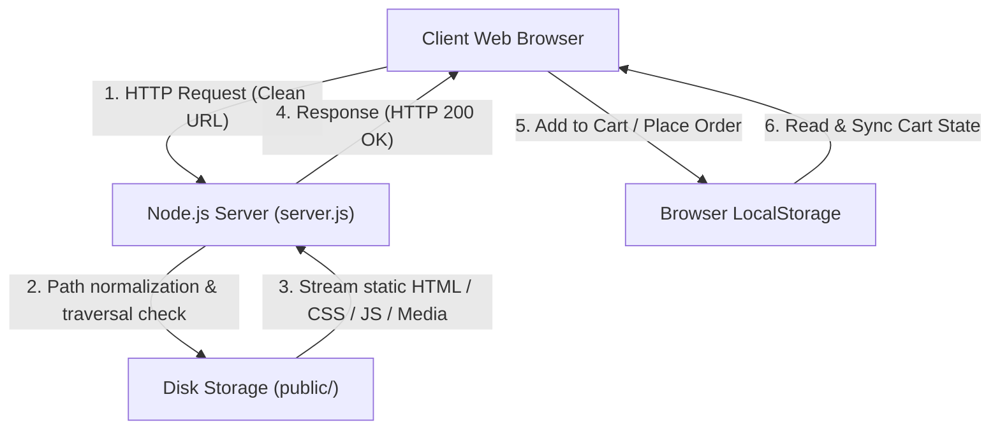

# Sneakers — High-Performance Sneaker E-Commerce Storefront

[](LICENSE)
[](https://nodejs.org)
[](package.json)
[]()

> A standalone, responsive sneaker e-commerce storefront featuring an interactive product visualizer, custom client-side shopping engine, and a clean URL Node.js server.

---

## 📸 Screenshots Showcase

| Home Page Hero | Best Sellers Carousel |
| :---: | :---: |
|  |  |

| Interactive Shoe Detail & Size Selector | Checkout & Billing Modal |
| :---: | :---: |
|  |  |

<div align="center">
  
  <p><em>Typography Centerpiece with Shoe Lace Overlay & Verified Brand Identity</em></p>
</div>

---

## ⚡ Features Overview

### 👟 Storefront & Catalog
- **Hero Showcase**: Dynamic footwear typography with responsive shoe overlays.
- **Horizontal Best-Sellers Slider**: Interactive carousel with left/right navigation controls.
- **Trending Collection Grid**: Vertical multi-brand shoe showcase visible on smooth scroll.
- **Catalog Page (`/shoes`)**: Grid layout displaying authentic collections from **Nike** and **Adidas**.
- **Pre-rendered Jamstack Architecture**: 17 dedicated individual shoe pages with rich product photography, descriptions, and specifications.

### 🛒 E-Commerce Engine (`shop-system.js`)
- **`localStorage` Persistence**: Shopping cart items, quantities, and past orders persist across sessions.
- **Minimalist Add-to-Cart `(+)`**: Crisp two-line black plus buttons on both product cards and detail pages. On cards, the icon remains permanently visible on hover and isolates clicks from card navigation links.
- **Real-Time Toast Notifications**: Animated slide-in toasts confirming product addition with thumbnail, chosen size, price, and cart drawer shortcut.
- **Interactive Shoe Size Selector**: Clickable shoe sizes (`UK 04` to `UK 10`) with isolated pill highlighting that preserves the clean white page background.
- **Real-Time Zoom Lens**: Interactive 2.2x magnifying lens on shoe detail pages that follows the cursor at 60/120 FPS via `requestAnimationFrame`.
- **Multi-Angle Thumbnail Switcher**: Clicking left-side angle thumbnails updates the primary shoe photo and synchronizes the magnifying zoom lens.
- **Slide-Over Cart Drawer**: Drawer displaying item thumbnails, sizes, quantity adjusters (`+`/`-`), removal actions, subtotal calculations, and checkout triggers.
- **Interactive Checkout Modal**:
  - Itemized order summary with live total computation.
  - Customer contact capture (**Full Name**, **Mobile Number**, **Delivery Address**) with auto-focus and `Enter` key support.
  - Three selectable billing options: **Cash on Delivery (COD)**, **UPI / Online QR**, and **Credit / Debit Card**.
  - Animated **Order Placed** confirmation screen featuring customer details and a unique 6-digit Order ID (`#SNK-XXXXXX`).

### 🎨 Design & Accessibility
- **Zero Watermarks**: Completely removed third-party editor bars, floating pencil buttons, and Framer badges.
- **Keyboard Shortcuts**: Pressing `Escape` (`ESC`) instantly closes modals or drawers.
- **Responsive Layout**: Fluid breakpoints optimized for mobile (320px+), tablet (768px+), and desktop (1200px+).

---

## 🏗️ Technical Architecture

Sneakers is built with a zero-dependency architecture. It pairs pre-rendered static HTML markup with a vanilla JavaScript e-commerce engine and a built-in Node.js server.



For in-depth architecture and design documents, see:
- [Architecture & Design Decisions](docs/architecture.md)
- [E-Commerce Engine Specification](docs/e-commerce-engine.md)
- [URL Routing & Navigation Specification](docs/routing-and-navigation.md)

---

## 📂 Repository Directory Structure

```text
sneakers/
├── server.js                   # High-performance zero-dependency Node.js HTTP server
├── package.json                # Project metadata & npm run scripts
├── .gitignore                  # Git ignore rules for Node projects
├── LICENSE                     # MIT License
├── README.md                   # Project documentation & guide
├── CHANGELOG.md                # Semantic version release notes
├── CONTRIBUTING.md             # Contribution guidelines
│
├── docs/                       # Technical & architectural specifications
│   ├── architecture.md         # System design and server pipeline
│   ├── e-commerce-engine.md    # Cart, zoom lens, and checkout specs
│   └── routing-and-navigation.md# Clean route mapping and SPA 404 bypass
│
├── screenshots/                # Application screenshots
│   ├── 01_homepage_hero.png
│   ├── 02_bestsellers_carousel.png
│   ├── 03_product_detail_page.png
│   ├── 04_checkout_modal.png
│   └── 05_footer_branding.png
│
└── public/                     # Static website root
    ├── index.html              # Home page
    ├── shoes.html              # Complete shoes catalog
    ├── about.html              # About Us page
    ├── shipping.html           # Shipping policy
    ├── returns.html            # Returns policy
    ├── privacy.html            # Privacy policy
    ├── terms-conditions.html   # Terms and conditions
    ├── shop-system.js          # Core shopping, cart & zoom logic (V5.0)
    ├── shop-system.css         # UI design system & responsive styling (V5.0)
    ├── shoes/                  # 17 individual sneaker product pages
    ├── stores/                 # Retail store location pages
    ├── magazine/               # Footwear culture magazine articles
    ├── images/                 # 590+ high-resolution shoe photos & assets
    ├── fonts/                  # Custom web typography (WOFF2)
    └── sites/                  # Localized modular scripts & chunks
```

---

## 🚀 Getting Started

### Prerequisites
- **Node.js**: v18.0.0 or higher ([Download Node.js](https://nodejs.org))
- **Git**: Installed on your system

### Installation & Launch

1. **Clone the repository**:
   ```bash
   git clone https://github.com/lahariannam2019/sneakers.git
   cd sneakers
   ```

2. **Start the local server**:
   ```bash
   npm start
   ```
   *(Alternatively: `node server.js`)*

3. **Open in your browser**:
   Navigate to **[http://localhost:3000](http://localhost:3000)**.

---

## 🌐 Available Routes

| Path | Description | Method |
| :--- | :--- | :--- |
| `/` | Storefront home page with Best Sellers & Trending grid | `GET` |
| `/shoes` | Sneaker catalog collection | `GET` |
| `/shoes/:slug` | Pre-rendered individual shoe page (e.g. `/shoes/adidas-kadhi-og`) | `GET` |
| `/about` | Brand story & mission statement | `GET` |
| `/shipping` | Shipping options & regional delivery times | `GET` |
| `/returns` | Return & exchange guidelines | `GET` |
| `/privacy` | Privacy policy & customer data safeguards | `GET` |
| `/terms-conditions` | Terms & conditions of service | `GET` |
| `/stores` | Retail store directory | `GET` |
| `/magazine` | Sneaker culture & editorial articles | `GET` |
| `/contact` | *Deprecated route* — automatically redirects to `/` | `302 Found` |

---

## 🔒 Security & Production Transparency

- **Local Storage Architecture**: This application operates as a self-contained local storefront. Customer information and orders are persisted exclusively in client-side `localStorage`.
- **Payment Processing Simulation**: Billing options (Cash on Delivery, UPI, Credit/Debit Card) simulate the frontend e-commerce order confirmation workflow. No live payment gateway or banking API keys are configured or exposed.
- **Path Traversal Protection**: The Node.js server resolves all file requests against `path.resolve(PUBLIC_DIR)` and blocks any traversal attempts outside the public root.
- **Clean Credentials**: No private keys, passwords, or personal workstation paths are committed to this repository.

---

## 🛠️ Technology Stack

- **Runtime**: Node.js (`http`, `fs`, `path`, ES Modules)
- **Frontend Core**: Vanilla JavaScript (ES6+), HTML5, CSS3 Custom Properties
- **State Management**: Browser `localStorage` API
- **Animation & Motion**: CSS3 Transforms, RequestAnimationFrame API, Hardware-Accelerated Viewport Transitions
- **Typography**: Ranchers, Inter, Playfair Display (WOFF2)
- **Version Control**: Git & GitHub

---

## 📄 License & Author

- **Author**: [Lahari Annam](https://github.com/lahariannam2019)
- **License**: Released under the [MIT License](LICENSE).
