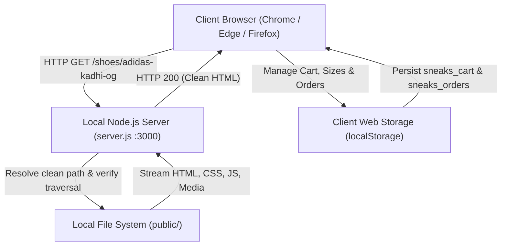

# System Architecture & Technical Design

This document details the software architecture, design decisions, and component interaction across the **Sneakers Local Sneaker E-Commerce Store**.



---

## 1. High-Level Architecture

Sneakers is designed as a **hybrid high-performance static architecture** combined with a **pure JavaScript client-side e-commerce engine**. 

### Key Architectural Tenets:
1. **Zero External Runtime Dependencies**: The server is built entirely with Node.js built-in modules (`http`, `fs`, `path`). No heavy frameworks (like Express) are required, keeping memory footprint under 25 MB and startup time under 50 ms.
2. **Pre-rendered Jamstack Delivery**: Product detail pages and catalog grids are fully pre-rendered HTML files, ensuring instant initial load time, SEO-friendly markup, and zero client-side hydration delays.
3. **Local State Persistence**: All shopping activities (cart items, quantities, selected sizes, and submitted orders) are preserved locally in the browser's `localStorage` (`sneaks_cart` and `sneaks_orders`).
4. **Resilient Dual-Layer Routing**: Navigation directly serves disk-backed static files via clean URLs (`/shoes/:slug`), completely avoiding client-side routing exceptions or broken state.

---

## 2. Server Architecture (`server.js`)

The backend server is implemented in `server.js` and provides four critical services:

### A. Clean URL Resolution Pipeline
When a user requests a path like `/shoes/adidas-kadhi-og`:
1. The server normalizes the URI and decodes path components.
2. It tests a priority list of candidate paths:
   - `public/${cleanPath}` (exact file or directory)
   - `public/${cleanPath}.html` (clean extensionless HTML file)
   - `public/${cleanPath}/index.html` (directory index file)
3. If a matching file exists on disk, it is served immediately.

### B. Path Traversal Security
To prevent malicious directory traversal (`../../` attacks), every candidate path is resolved using `path.resolve()` and validated:
```javascript
const resolved = path.resolve(candidate);
if (!resolved.startsWith(PUBLIC_DIR)) {
  res.writeHead(403, { 'Content-Type': 'text/plain' });
  return res.end('403 Forbidden: Invalid file path');
}
```

### C. Automatic Redirects
Deprecated or removed routes (such as the legacy `/contact` endpoint) are cleanly redirected using standard HTTP 302:
```javascript
if (pathname === '/contact' || pathname === '/contact/' || pathname.startsWith('/contact')) {
  res.writeHead(302, { Location: '/' });
  return res.end();
}
```

### D. Efficient Streamed I/O & Caching
Assets are served using `fs.createReadStream()` with standard MIME types and `Cache-Control: no-cache` for instant local development feedback.

---

## 3. Frontend Architecture

### Component Hierarchy
- **`public/index.html`**: Storefront home page featuring:
  - Hero banner with animated footwear typography.
  - Horizontal Best Sellers slider with `< >` directional controls.
  - Vertical Trending Collection grid.
  - Brand footer with "SNEAKERS" typographic centerpiece.
- **`public/shoes.html`**: Complete multi-brand sneaker catalog with Nike and Adidas product cards.
- **`public/shoes/*.html`**: 17 dedicated individual sneaker pages featuring multi-angle photography, pricing, sizing, and details.
- **`public/shop-system.css`**: Centralized stylesheet enforcing pure white background aesthetics, hiding third-party badges, and styling custom shopping components.
- **`public/shop-system.js`**: Core client-side engine managing shopping state, UI modals, image magnifying, and user interactions.
