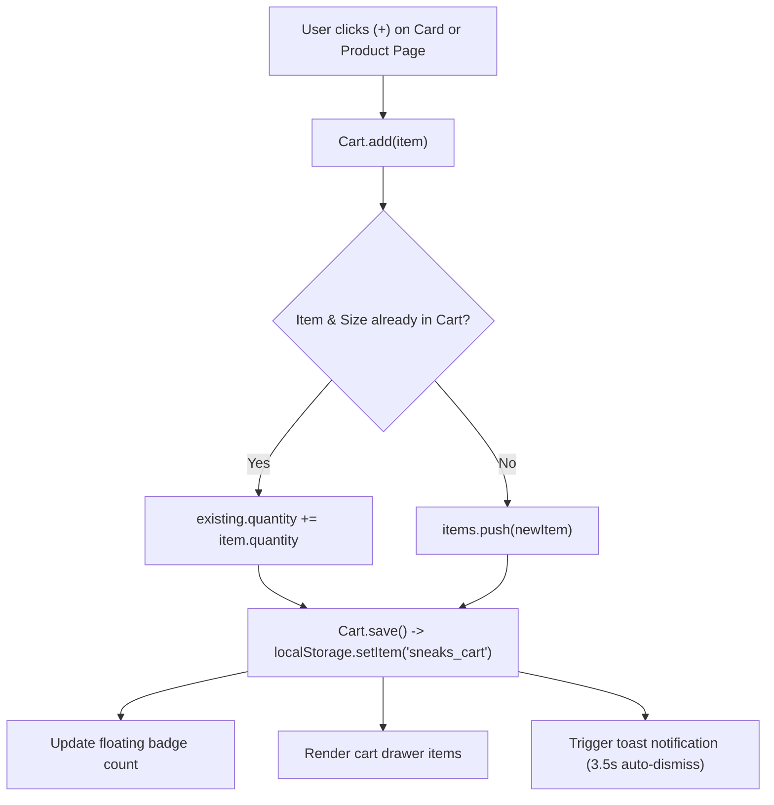
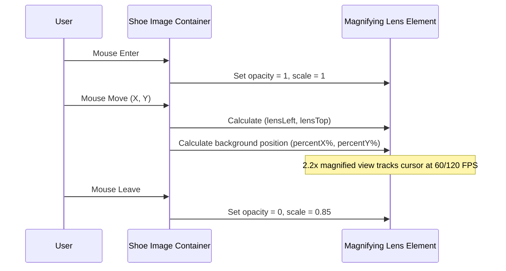
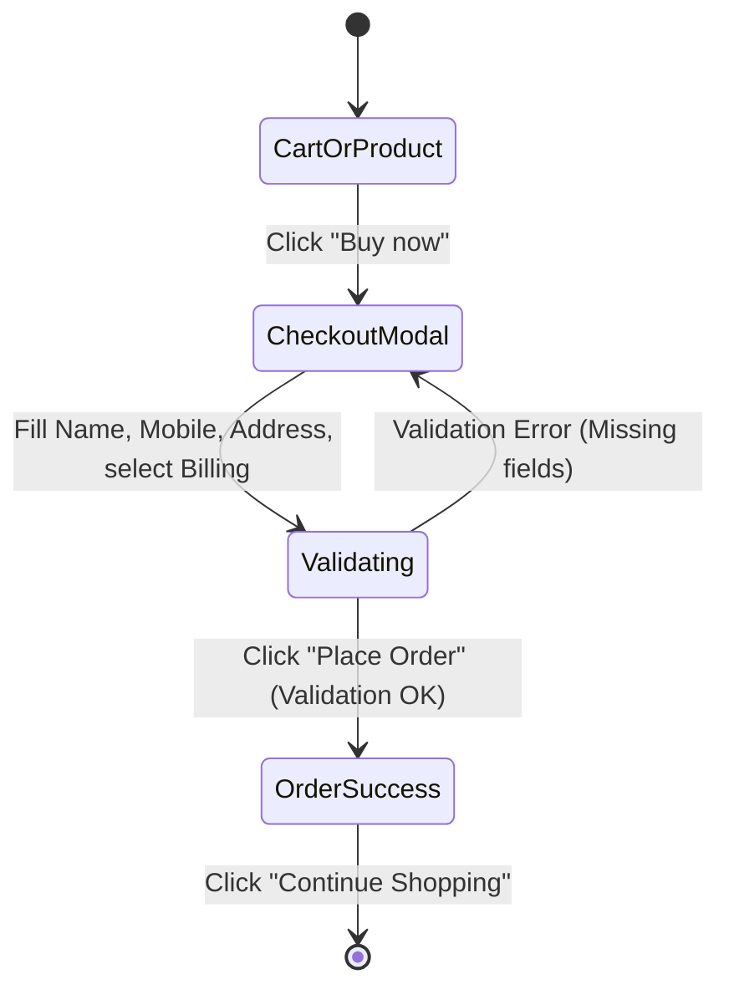

# E-Commerce Engine & Shopping Workflow

This document explains the technical implementation of the shopping cart, size selector, checkout workflow, and interactive zoom lens built into `public/shop-system.js`.

---

## 1. Shopping Cart Lifecycle (`Cart` Object)

The cart subsystem is structured as a singleton object managing `localStorage` synchronization:



### Cart Data Schema:
```json
[
  {
    "id": "/shoes/adidas-kadhi-og-UK 07",
    "title": "Adidas Kadhi OG",
    "price": "$115.00",
    "size": "UK 07",
    "image": "/images/mHScIQT5WNYeUKqkIQbiTWNY.png",
    "quantity": 1
  }
]
```

### Key Cart Methods:
- `Cart.get()`: Retrieves and parses the cart array safely from `localStorage`.
- `Cart.add(item)`: Appends an item or increments quantity if an identical product and size already exists.
- `Cart.remove(index)`: Removes an item from the cart array.
- `Cart.updateQty(index, delta)`: Adjusts quantity (minimum bound: 1).
- `Cart.total()`: Computes total dollar amount parsed via regex from price strings.
- `Cart.count()`: Returns the sum of all item quantities.

---

## 2. Surgical Shoe Size Selection

Shoe sizes (`UK 04`, `UK 05`, `UK 06`, `UK 07`, `UK 08`, `UK 09`, `UK 10`) are selectable interactively without affecting the surrounding page layout or background color:

1. **Targeting**: Queries `<p>` elements matching the exact size whitelist.
2. **Pill Isolation**: Targets strictly the immediate button container (`.framer-7yVgN`) and text node.
3. **Active State**: Inverts colors (`#000000` background, `#ffffff` text) on the active size, while resetting inactive pills to light gray (`rgb(240, 240, 240)` background, `#000000` text).
4. **State Storage**: Stores selection in `currentSelectedSize` (default: `'UK 07'`), which is passed directly to cart additions and checkout.

---

## 3. Interactive Magnifying Zoom Lens

When viewing a shoe detail page, users can inspect fine leather textures, stitching, and sole materials using a real-time magnifying lens:



### Zoom Specifications:
- **Lens Size**: 280px × 280px with a 40px squircle border-radius.
- **Magnification Factor**: 2.2× scale with `background-position: percentX% percentY%`.
- **Performance**: Event coordinates are throttled using `requestAnimationFrame` for buttery-smooth 60/120 FPS performance.
- **Angle Synchronization**: Clicking any left-hand thumbnail switches the main photo, updates the active border, and instantly syncs the lens background image.

---

## 4. Checkout Workflow & Order Confirmation



### Order Placement Logic:
1. **Invocation**: Triggered by clicking "Buy now" on any shoe detail page or inside the slide-over cart drawer.
2. **Validation**: Enforces non-empty values for **Full Name**, valid **Mobile Number** (minimum 6 characters), and **Delivery Address**.
3. **Billing Options**:
   - Cash on Delivery (COD) — *Selected by default*
   - UPI / QR Code / Online
   - Credit / Debit Card
4. **Order Record**:
   - Generates a unique 6-digit Order ID: `#SNK-XXXXXX`.
   - Clears the active shopping cart.
   - Saves the transaction to `localStorage` under `sneaks_orders`.
   - Transitions modal to a confirmation screen displaying Customer Name, Order ID, Delivery Address, Payment Method, and Total Amount.
